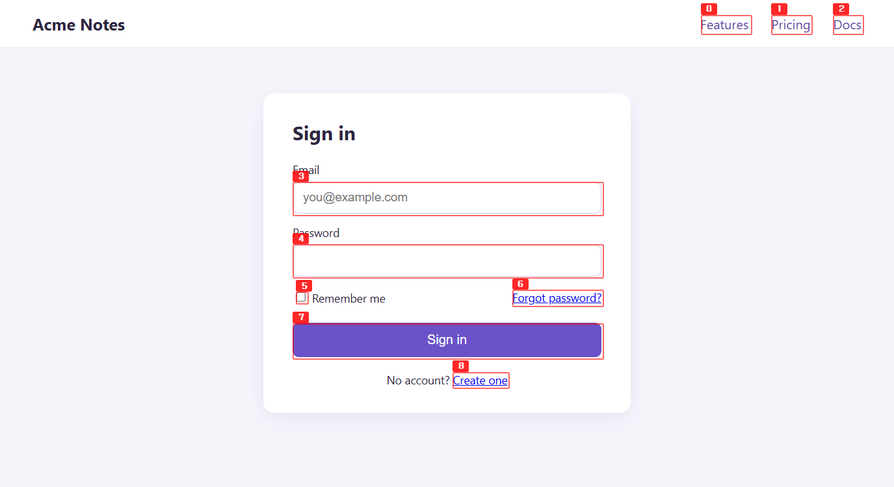

<p align="center"></p>

# dalzzack

> Browser automation CLI for AI agents. Screenshot-first, token-efficient.

dalzzack spawns a real browser window as a daemon and lets an AI agent (Claude, GPT, whatever) drive it through a small CLI. Built on Tauri 2 with native WebView APIs: no Chromium fork, no Playwright runtime, just the OS WebView and one Rust binary (about 37 MB on Windows).

Each `--id` is an isolated browser instance, so you can run agents in parallel.

---

## Why screenshot-first?

Most agent-controlled browsers default to `get_html` for page understanding. That's expensive. Modern pages routinely run into hundreds of thousands of tokens.

We measured seven sites at a 1280×800 viewport. HTML token counts use `chars/3.3` (typical BPE ratio for HTML); screenshot uses Anthropic's vision formula `(W×H)/750` after auto-resize to ~1.15 MP.

| Site | Raw HTML tokens | Stripped HTML tokens | Screenshot tokens | Verdict |
|------|---:|---:|---:|---|
| example.com | 155 | 107 | 1,531 | HTML wins (14×) |
| news.ycombinator.com | 10,547 | 10,297 | 1,531 | screenshot **6.7×** |
| google.com | 26,922 | 1,902 | 1,531 | tie (1.2×) |
| en.wikipedia.org | 31,928 | 26,654 | 1,531 | screenshot **17×** |
| naver.com | 92,379 | 27,948 | 1,531 | screenshot **18×** |
| github.com/trending | 191,923 | 147,859 | 1,531 | screenshot **97×** |
| amazon.com | 298,750 | 123,053 | 1,531 | screenshot **80×** |

**Screenshot cost is a flat ~1,500 tokens regardless of page size. HTML scales linearly with the DOM.** Break-even is around 5,000 chars of HTML. Below that, prefer HTML. Above, prefer a screenshot. Real-world sites are almost always above.

So `describe` and `screenshot` are the recommended primitives. Use `get-html` only when a specific value (hidden field, token, API response) can't be seen on screen.

---

## Install

macOS:

```bash
curl -fsSL https://raw.githubusercontent.com/gosuda/dalzzack/main/scripts/install.sh | sh
```

Windows (PowerShell):

```powershell
irm https://raw.githubusercontent.com/gosuda/dalzzack/main/scripts/install.ps1 | iex
```

Then open a new terminal and give your agents the usage guide:

```bash
dalzzack --version
dalzzack install all
```

The script downloads the latest [release](https://github.com/gosuda/dalzzack/releases), checks its SHA-256 hash, installs the binary, and adds it to your `PATH`. It needs no Rust, no Node.js, and no administrator rights. To read it before you run it, see [install.sh](scripts/install.sh) and [install.ps1](scripts/install.ps1).

| | macOS (universal) | Windows (x64) |
|---|---|---|
| Binary | `~/.local/bin/dalzzack` | `%LOCALAPPDATA%\Programs\dalzzack\dalzzack.exe` |
| `PATH` change | One line in `~/.zshenv`, or in your bash profile | Your user `Path` |

To change this, set these environment variables before you run the script:

- `DALZZACK_INSTALL_DIR`: the folder for the binary.
- `DALZZACK_NO_MODIFY_PATH=1`: do not change `PATH`.

Windows needs the WebView2 runtime, which Windows 11 already has.

### Manual download

Each [GitHub release](https://github.com/gosuda/dalzzack/releases) has `dalzzack-macos-universal.tar.gz` and `dalzzack-windows-x64.zip`, each with a `.sha256` file. Extract the binary into a folder on your `PATH`.

To check a download, fetch the `.sha256` file with the same name. On macOS, run `shasum -a 256 -c dalzzack-macos-universal.tar.gz.sha256`. On Windows, compare its hash with `(Get-FileHash dalzzack-windows-x64.zip).Hash`.

The macOS binary is not notarized by Apple. A file that `curl` downloads runs as it is. If you downloaded the archive in a browser, macOS blocks the binary until you clear its quarantine flag, once for each download:

```bash
xattr -d com.apple.quarantine <path to dalzzack>
```

If you downloaded the zip in a browser and Windows blocks the program, run `Unblock-File <path to dalzzack.exe>` once.

### Build from source (needs Rust)

Pick whichever fits your setup. All three install the same binary to a directory on your `PATH`.

```bash
# 1. From git (fastest — needs Rust only, no Node.js)
cargo install --git https://github.com/gosuda/dalzzack --locked

# 2. From a local clone (best if you want to hack on it)
git clone https://github.com/gosuda/dalzzack && cd dalzzack
cargo install --path src-tauri --locked

# 3. Full developer build (rebuilds the React landing too)
git clone https://github.com/gosuda/dalzzack && cd dalzzack
npm install && npm run deploy   # frontend + cargo + ad-hoc codesign (macOS)

dalzzack --help
```

Platforms: macOS (WKWebView) and Windows (WebView2). Linux (WebKitGTK) code exists, but CI does not build or test it and releases do not include it. On macOS the deploy script ad-hoc codesigns; the cargo paths leave codesigning to you (run `codesign --force --sign - $(which dalzzack)` if you hit Gatekeeper).

### Updating

To update a prebuilt binary, run the install command again, then run `dalzzack install all` so the guide matches. Running daemons keep the old version until you stop them (`dalzzack list`, then `dalzzack stop --id <id>`). For a manual download, stop them first, because Windows cannot overwrite a `dalzzack.exe` that is running.

For a build from source, the simplest path is the self-update command. It needs cargo; without it, it fails with `cargo_not_found` and prints the download link instead. It stops any running daemons, then runs `cargo install --force` against the URL baked into the binary at build time:

```bash
dalzzack upgrade                              # default: git URL from Cargo.toml
dalzzack upgrade --rev v1.0.0                 # pin to a tag or sha
dalzzack upgrade --path ~/src/dalzzack/src-tauri   # local clone (dev mode)
dalzzack upgrade --git https://github.com/<you>/dalzzack   # use a fork
```

Flags:

- `--keep-daemons`: refuse to upgrade if any daemons are running (default is to stop them).
- `--no-locked`: drop the `--locked` flag passed to cargo install. Use only when you've intentionally moved past the committed `Cargo.lock`.

The end-to-end test in CI ran this in 2 s against a local `--path`, including stopping a live daemon.

If you'd rather not use the self-update flow, the bare cargo commands work too:

```bash
cargo install --git https://github.com/gosuda/dalzzack --locked --force
cargo install --path src-tauri --locked --force

# stop daemons first if you have any running
dalzzack list                       # see what's alive
dalzzack stop --id <each>           # graceful shutdown
dalzzack kill --id <id>             # escape hatch if a daemon is wedged
```

A future release will be published to crates.io so `cargo install dalzzack` works without the `--git` URL.

Coming from TaskWeaver, the private predecessor? Follow the [migration steps](CHANGELOG.md#migrating-from-taskweaver).

---

## Quick start

```bash
dalzzack start --id b                                           # spawn browser window
dalzzack navigate -i b --url "https://example.com"
dalzzack describe -i b                                          # annotated screenshot + element list
dalzzack click -i b --text "Sign In"                            # click by visible text
dalzzack fill-form -i b --selector "#email" --value "you@x.com"
dalzzack wait-for -i b --selector ".result" --state added
dalzzack screenshot -i b
dalzzack stop --id b
```

`start` opens a landing screen showing the instance id and ready status. From that point, every command talks to the daemon over a local TCP socket.

---

## Recommended agent loop

```
describe → click/fill → wait-for → screenshot → next
```

Rules of thumb:

- `describe` first on any new page. It labels every interactive element with a number so the agent can pick by index instead of guessing selectors.
- Prefer `click --text` or `click --selector` over coordinate clicks. Coordinates break on resize.
- Use `wait-for --state added` (event-driven) instead of `wait --ms` (timer-driven).
- Use `get-requests` to read API responses instead of scraping rendered HTML.
- Use `get-html` only when a value (hidden token, raw text) cannot be seen on screen.

This is `describe` on a sign-in page. Every interactive element gets a number, and the JSON result lists the same numbers with each element's tag, text and position:

<p align="center"></p>

---

## Documentation

- [Command reference](docs/commands.md): every command and flag, with platform notes.
- [Architecture](docs/architecture.md): how the CLI talks to the daemon, the platform matrix, and the design decisions.
- [AGENTS.md](AGENTS.md): the usage guide that `dalzzack install` writes for agents.
- [SECURITY.md](SECURITY.md): the threat model. Read it before you point a daemon at sites you do not trust.
- [CHANGELOG.md](CHANGELOG.md): release notes.

---

## Agent integration

Write the usage guide into your agent's instruction file:

```bash
dalzzack install claude-code     # ~/.claude/CLAUDE.md (global, all projects)
dalzzack install codex           # ~/.codex/AGENTS.md or $CODEX_HOME/AGENTS.md (global, all projects)
dalzzack install all             # both
dalzzack install codex-project   # ./AGENTS.md (current project)
```

Use `codex-project` only when you want the guide in one repository. Codex reads only the first 32 KiB of project files, and the guide is longer than that. To read all of it, set `project_doc_max_bytes = 65536` in `~/.codex/config.toml`. The global file has no such limit.

The guide sits between `<!-- dalzzack-begin -->` and `<!-- dalzzack-end -->`. Running the command again replaces that block with the current guide, so run it again after an upgrade. For other agents, copy [AGENTS.md](AGENTS.md) into their instruction file.

---

## Development

```bash
# Build & install CLI
cd src-tauri && cargo install --path . --force

# Or full deploy (frontend + Rust + install + codesign)
npm run deploy

# Tests
cd src-tauri && cargo test --lib --bins

# Help
dalzzack --help
dalzzack <command> --help
```

### CI / release

GitHub Actions workflows:
- **CI** (`ci.yml`): format check, Clippy and unit tests (macOS), build (macOS, Windows), smoke test (macOS)
- **Release** (`release.yml`): on `v*` tags, builds the binary with `tauri build --no-bundle` and attaches `dalzzack-macos-universal.tar.gz` and `dalzzack-windows-x64.zip`, each with a `.sha256` file, to the GitHub release. It publishes no installers: they did not put `dalzzack` on `PATH`. A tag with a hyphen, such as `v1.0.0-rc.1`, makes a pre-release, which the `releases/latest` links skip.

---

## Contributing

Issues and PRs are welcome. Read [CONTRIBUTING.md](CONTRIBUTING.md) first. Report security issues privately, as [SECURITY.md](SECURITY.md) describes.

---

## License

MIT. See [LICENSE](LICENSE).
